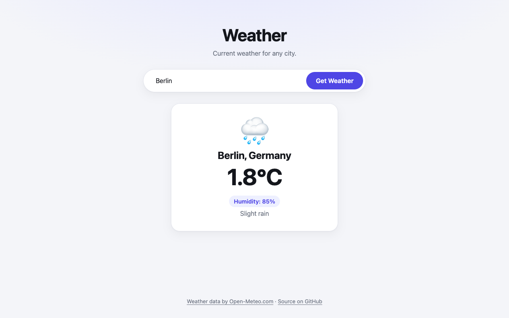

# Weather

A small web app that shows the current weather for any city. Weather data by [Open-Meteo.com](https://open-meteo.com/).



## Features

- Search by city name
- Temperature in °C, humidity, a short description and a matching emoji
- Separate messages for empty input, an unknown city, a service error and a lost connection
- Responsive layout

## Tech

- HTML, CSS, vanilla JavaScript
- `fetch` with `async`/`await`
- Open-Meteo [Geocoding API](https://open-meteo.com/en/docs/geocoding-api) (city name to coordinates) and [Forecast API](https://open-meteo.com/en/docs) (current weather); neither needs an API key
- Tests with Node's built-in test runner

## How to run

Open the live version: **[aaronkuy.github.io/weather](https://aaronkuy.github.io/weather/)**

Or run it locally. There is no build step and no dependency:

```bash
git clone https://github.com/aaronkuy/weather.git
cd weather
open index.html        # macOS; on Linux use xdg-open, on Windows start
```

## Tests

`weather.js` holds the logic that needs neither the DOM nor the network: building the request URLs, reading the API answers, mapping weather codes, formatting, choosing the error message. The tests need Node.js and no packages:

```bash
node --test
```

The same command runs on every pull request and on every push to `main` (`.github/workflows/test.yml`).

## What I learned

- Calling an API and checking `response.ok` before using the data
- Destructuring nested JSON
- Creating and styling DOM elements from JavaScript

## What I'd do next

- Use the user's location as a default
- A five-day forecast

## Notes

- The app no longer uses an API key.
- A search takes the first match the geocoding API returns for the name, so "Paris" shows Paris in France and not Paris, Texas.
- Open-Meteo's free API is for non-commercial use and has a daily request limit; see their [terms](https://open-meteo.com/en/terms).

## Credits

- This project started from Bro Code's tutorial [Create a weather app with JavaScript!](https://www.youtube.com/watch?v=VaDUGPMjzOM). The structure of the script comes from that video: a form handler and the functions `getWeatherData`, `displayWeatherInfo`, `getWeatherEmoji` and `displayError`.
- Different from the tutorial: the data source (Open-Meteo instead of OpenWeather), the error handling, the weather code table, `weather.js` with its tests, and the page styling.
- Weather data by [Open-Meteo.com](https://open-meteo.com/), licensed under [CC BY 4.0](https://creativecommons.org/licenses/by/4.0/).

## License

See [LICENSE](LICENSE). It applies to what this repository adds to the tutorial code, not to the tutorial itself.
