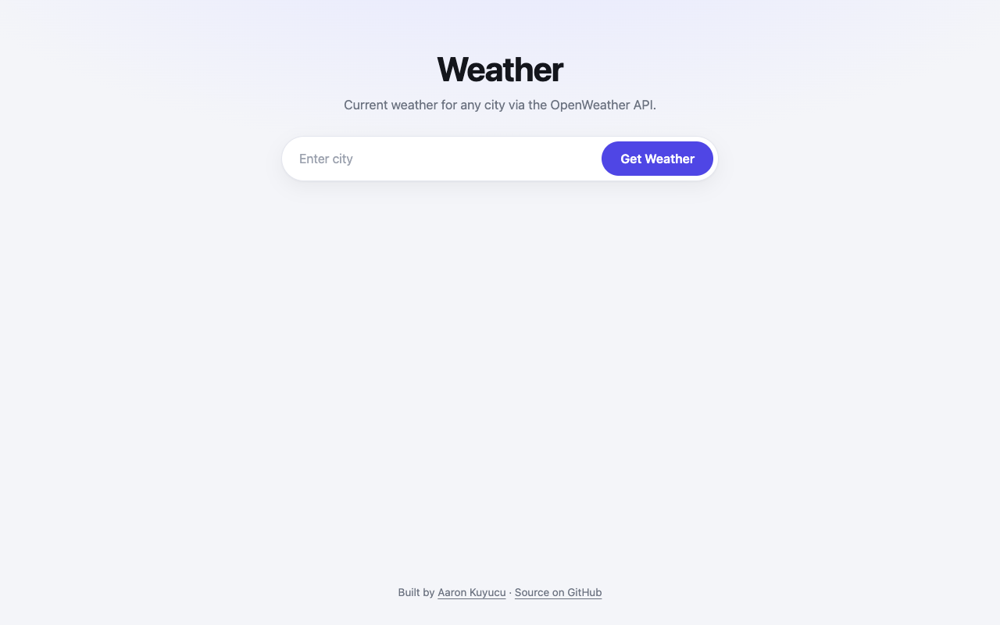

# Weather

A small web app that shows the current weather for any city through the OpenWeather API.



## Features

- Search by city name
- Temperature in °C, humidity, description and a matching emoji
- Clear error messages for empty input and unknown cities
- Responsive layout

## Tech

- HTML, CSS, vanilla JavaScript
- `fetch` with `async`/`await`
- OpenWeather Current Weather API

## How to run

Open the live version: **[aaronkuy.github.io/weather](https://aaronkuy.github.io/weather/)**

Or run it locally. There is no build step and no dependency:

```bash
git clone https://github.com/aaronkuy/weather.git
cd weather
open index.html        # macOS; on Linux use xdg-open, on Windows start
```

## What I learned

- Calling an API and checking `response.ok` before using the data
- Destructuring nested JSON
- Creating and styling DOM elements from JavaScript

## What I'd do next

- Request metric units from the API instead of converting Kelvin
- Use the user's location as a default
- A five-day forecast

## Notes

The API key is client-side by design of this exercise; it will be rotated and restricted.

## License

See [LICENSE](LICENSE).
